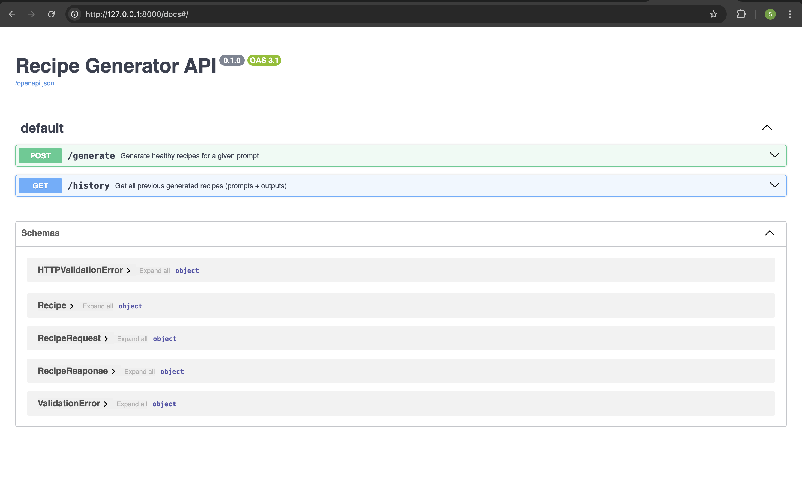
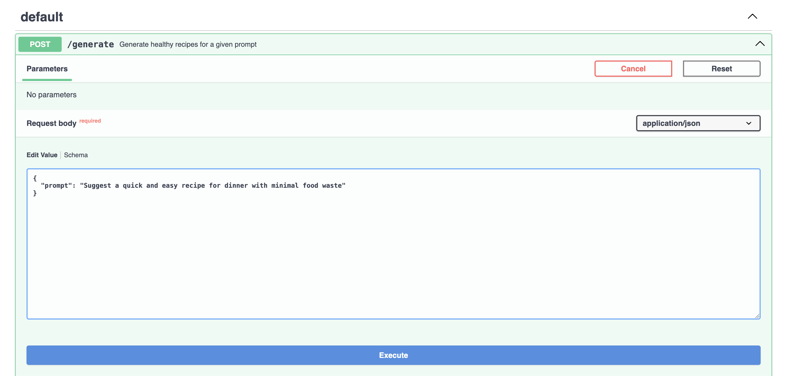
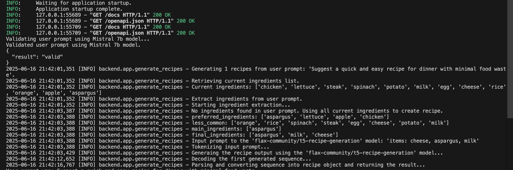
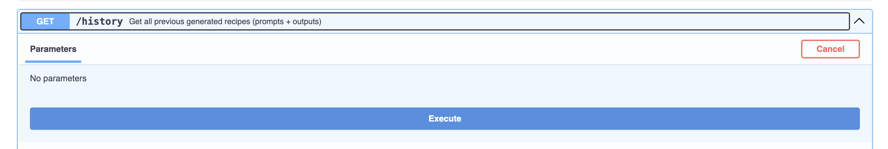

## API Documentation
- Open Swagger UI to explore and test the APIs:
    - [Swagger UI](http://127.0.0.1:8000/docs)
    

    #### API Information and Usage Guide

    ##### Available APIs

    ###### 1. `/generate` API
    - **Method**: POST
    - **Description**: Generates recipes based on the provided prompt.
    - **Endpoint**: `/generate`
    - **Payload**:
        ```json
        {
            "prompt": "Suggest a quick and easy recipe for dinner with minimal food waste"
        }
        ```
    - **Response**:
        ```json
        {
            "recipe": "Generated recipe details"
        }
        ```
    - **Usage with Swagger UI**:
        - First, click on the `/generate` API and then click the **Try it out** button.

        - Enter the desired prompt in the text field.

        - Click on **Execute** and wait for the response.

            
        - You can monitor the application logs directly in the terminal where the application is running. Below is an example of how the logs might appear:

            

        - Example Response for `/generate` API

            On successful generation, you should see a response similar to below in the response body (approximate response time currently: 1 minute):

            ```json
            {
                "recipes": [
                    {
                        "title": "Vegetable-Stuffed Baked Potatoes",
                        "description": "A quick and easy dinner recipe utilizing potatoes, spinach, and lettuce to minimize food waste.",
                        "time": "90",
                        "ingredients": [
                            "2 medium potatoes",
                            "1 cup cooked spinach",
                            "1 head lettuce",
                            "1 tablespoon olive oil",
                            "salt and pepper, to taste"
                        ],
                        "directions": [
                            "Preheat oven to 400°F (204°C).",
                            "Wash potatoes thoroughly. Pierce with a fork several times.",
                            "Brush potatoes with olive oil and season with salt and pepper.",
                            "Bake potatoes for approximately 50 minutes or until soft.",
                            "While the potatoes bake, wilt spinach in a pan over medium heat.",
                            "Once cooled, carefully scoop out potato pulp from the baked potatoes. Leave about 1/4 inch thickness on the skin.",
                            "Combine cooked spinach with the potato pulp and season with salt and pepper to taste.",
                            "Fill each potato skin with the spinach-potato mixture.",
                            "Tear lettuce leaves and use them as wraps around the stuffed potatoes.",
                            "Serve immediately.",
                            "To avoid food waste, store leftovers in an airtight container for up to 3 days or freeze for later consumption."
                        ],
                        "labels": [
                            "vegetarian",
                            "low-waste"
                        ],
                        "warnings": [
                            "Ensure proper hand washing and clean cooking surfaces to prevent cross-contamination.",
                            "Avoid consuming undercooked spinach."
                        ],
                        "notes": [
                            "Serve with a side of salsa or sour cream for added flavor. Try using the potato scraps for mashed potatoes or potato soup.",
                            "Compost lettuce leaves and any unused potato peels."
                        ],
                        "nutrition": [
                            "calories: 400 kcal per serving",
                            "protein: 8g per serving",
                            "carbohydrates: 75g per serving",
                            "fiber: 6g per serving",
                            "iron: 3mg per serving"
                        ]
                    }
                ]
            }
            ```

    ###### 2. `/history` API
    - **Method**: GET
    - **Description**: Retrieves all previously generated recipes.
    - **Endpoint**: `/history`
    - **Response**:
        ```
        [
          {
              "recipes": [{...}, {...}, ...]
          }
        ]
        ```
    - **Usage with Swagger UI**:
        - First, click on the `/history` API and then click the **Try it out** button.
        - Click on **Execute** and wait for the response.

            

        - You will be able to view the list of all previously generated recipes.


    #### Notes
    - Ensure the application is running before making API requests.
    - The `/generate` API requires a valid JSON payload with the `prompt` field.
    - The `/history` API does not require any payload and returns a list of all generated recipes.


## Prompt Engineering

You can customize internal prompts used by the application by editing the prompts in the `backend/apps/prompts.py` file. This allows you to tailor the behavior of the AI model to better suit your specific requirements.
#### Prompt Templates

###### 1. `REFINE_RECIPE_PROMPT_TEMPLATE`
- **Purpose**: This prompt is used to refine the generated recipes, ensuring they are coherent, detailed, and aligned with the application response schema requirements.
- **Customization**: Feel free to experiment with this prompt to enhance recipe quality or add creative elements. However, ensure the changes do not compromise the application's functionality.
